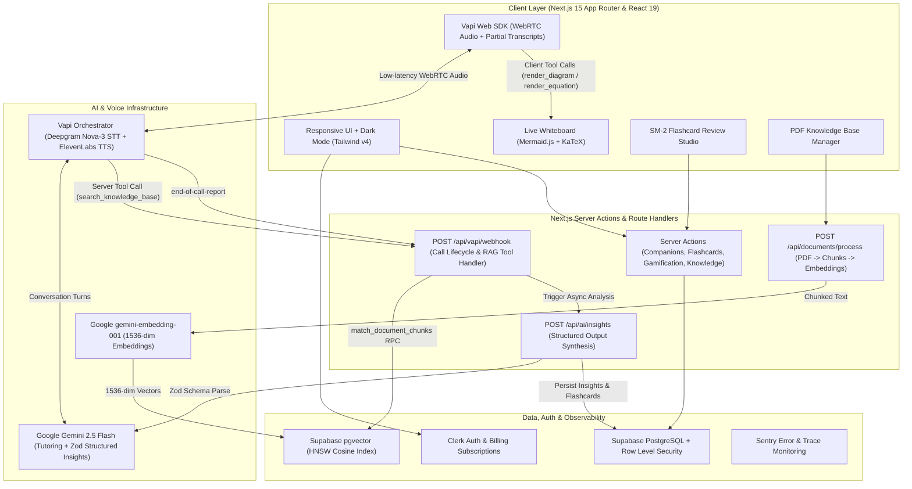
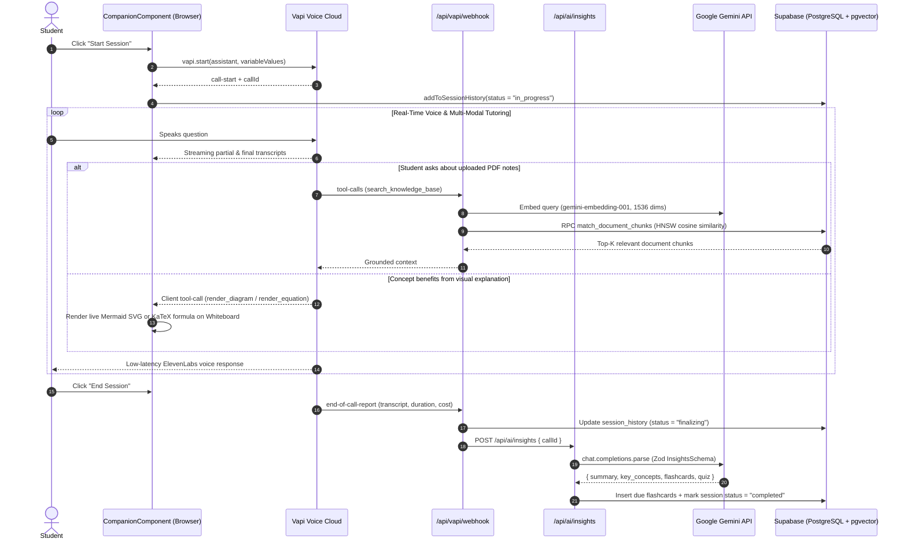
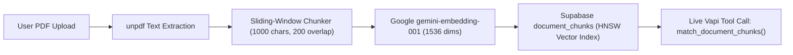
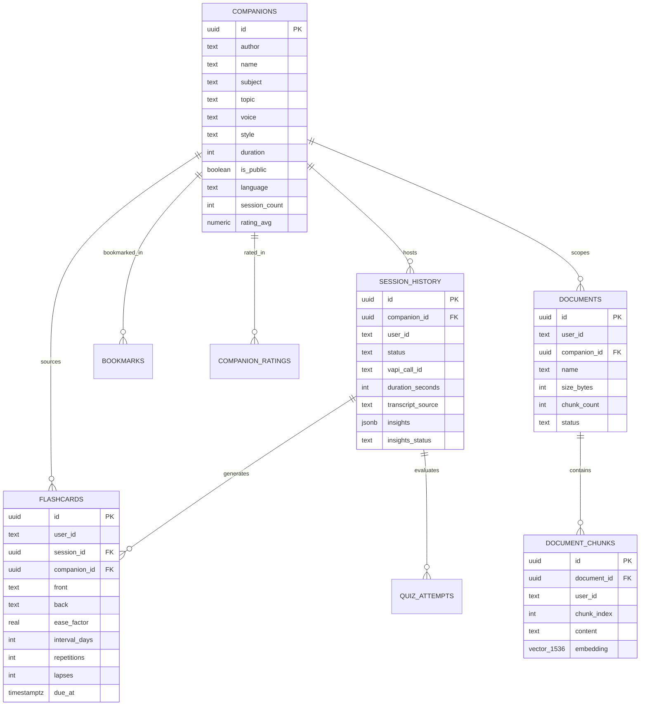

<div align="center">

  <div>
    
    
    
    
    
    
    
    
  </div>

  <br />

  <h1>NeuraNest — Real-Time AI Voice Tutoring & Adaptive Learning Platform</h1>

  <p align="center">
    An interactive AI learning platform combining <strong>low-latency voice companions</strong>, <strong>RAG document grounding (pgvector)</strong>, a <strong>live Mermaid & KaTeX visual whiteboard</strong>, <strong>SuperMemo SM-2 spaced repetition flashcards</strong>, and <strong>deterministic gamification analytics</strong>.
  </p>

  
</div>

---

## 📋 Table of Contents

1. [Overview](#-overview)
2. [System Architecture](#-system-architecture)
3. [Voice Session & AI Insights Pipeline](#-voice-session--ai-insights-pipeline)
4. [RAG Knowledge Base Pipeline](#-rag-knowledge-base-pipeline)
5. [Database Schema (ERD)](#-database-schema-erd)
6. [Key Features](#-key-features)
7. [Tech Stack](#-tech-stack)
8. [Local Setup & Environment Variables](#-local-setup--environment-variables)
9. [Testing & Verification](#-testing--verification)

---

## 🧠 Overview

**NeuraNest** transforms passive self-study into an active, multi-modal tutoring experience. Students create or pick specialized AI voice companions across subjects (`Maths`, `Science`, `Coding`, `Language`, `History`, `Economics`), upload their own PDF lecture notes into a vector knowledge base, and converse naturally in real time.

During a live voice session, the AI tutor can:
- **Search uploaded study notes** via semantic vector similarity (`pgvector` + Google `gemini-embedding-001`) to ground answers in the student's curriculum.
- **Draw live visual explanations** on an interactive split-screen whiteboard using **Mermaid.js** flowcharts/diagrams and **KaTeX** mathematical equations.
- **Automatically synthesize post-session learning artifacts** (structured summary, key concepts, multiple-choice quizzes, and **SM-2 spaced repetition flashcards**) when the call ends.

---

## 🏗️ System Architecture



---

## 🎙️ Voice Session & AI Insights Pipeline



---

## 📄 RAG Knowledge Base Pipeline



---

## 🗄️ Database Schema (ERD)



---

## ✨ Key Features

- **🎙️ Real-Time Voice AI Companions**: Configurable voice tutors powered by Vapi, Deepgram Nova-3/Nova-2 speech-to-text, Google `gemini-2.5-flash`, and ElevenLabs voices with live partial-to-final transcript streaming.
- **📐 Live Interactive Whiteboard**: Client-side Vapi function tools (`render_diagram` and `render_equation`) dynamically open a split-screen canvas rendering **Mermaid.js** diagrams and **KaTeX** equations during the conversation.
- **📚 RAG Knowledge Base (`pgvector`)**: Upload PDF study notes in `/knowledge`. Documents are parsed server-side with `unpdf`, chunked with sliding-window overlap, embedded with Google `gemini-embedding-001` (`1536` dimensions), indexed with an HNSW cosine index, and queried mid-call via `search_knowledge_base`.
- **🧠 SuperMemo SM-2 Spaced Repetition**: Post-call transcripts are analyzed with Zod structured outputs to generate flashcards. Review due cards at `/review` with Anki-style grade buttons (`Again`, `Hard`, `Good`, `Easy`), live next-interval previews, and instant keyboard shortcuts (`Space`, `1`–`4`).
- **🏆 Deterministic Gamification Engine**: XP, level progression, daily/longest study streaks, and 10 achievement badges on `/my-journey` are computed as a pure function over source-of-truth session, quiz, and flashcard records—preventing state drift and enabling fast unit testing.
- **🎨 Design-Engineered UI**: Built with custom cubic-bezier easing curves, GPU-accelerated transitions, capability-gated hover states (`@media (hover: hover) and (pointer: fine)`), `prefers-reduced-motion` support, and mobile-native viewport handling (`100dvh`, safe-area insets, zero tap-highlight flash).

---

## ⚙️ Tech Stack

| Layer | Technology |
| :--- | :--- |
| **Framework** | Next.js 15.3 (App Router, Server Actions, Turbopack), React 19, TypeScript 5 |
| **Styling & Motion** | Tailwind CSS v4, Radix UI / shadcn/ui, Lucide Icons, Lottie, Custom CSS Easing Tokens |
| **Voice & AI** | Vapi Web SDK (`@vapi-ai/web`), Google Gemini (`gemini-2.5-flash`, `gemini-embedding-001`), Deepgram, ElevenLabs |
| **Visual Rendering** | Mermaid.js v12 (Diagrams), KaTeX (LaTeX Math Rendering) |
| **Database & Vector Search** | Supabase PostgreSQL, `pgvector` (HNSW Cosine Index), Row Level Security (RLS) |
| **Auth & Billing** | Clerk (`@clerk/nextjs`) Authentication & Subscription Plan Gating |
| **Observability & Testing** | Sentry (`@sentry/nextjs`), Vitest (Unit Testing) |

---

## 🚀 Local Setup & Environment Variables

### 1. Clone and install dependencies

```bash
git clone https://github.com/ishan1603/NeuraNest.git
cd NeuraNest
npm install
```

### 2. Run Supabase migrations

In your Supabase project's **SQL Editor**, run the migrations in order:
1. `supabase/migrations/0001_base_schema.sql`
2. `supabase/migrations/0002_v2_platform.sql`

### 3. Configure `.env.local`

Create a `.env.local` file in the project root:

```env
# Clerk Authentication
NEXT_PUBLIC_CLERK_PUBLISHABLE_KEY=pk_test_...
CLERK_SECRET_KEY=sk_test_...
NEXT_PUBLIC_CLERK_SIGN_IN_URL=/sign-in
NEXT_PUBLIC_CLERK_SIGN_UP_URL=/sign-up
NEXT_PUBLIC_CLERK_AFTER_SIGN_IN_URL=/
NEXT_PUBLIC_CLERK_AFTER_SIGN_UP_URL=/

# Supabase (Database + pgvector)
NEXT_PUBLIC_SUPABASE_URL=https://your-project-ref.supabase.co
NEXT_PUBLIC_SUPABASE_ANON_KEY=eyJ...
SUPABASE_SERVICE_ROLE_KEY=eyJ...

# Vapi Voice AI
NEXT_PUBLIC_VAPI_PUBLIC_KEY=your_vapi_public_key

# Google Gemini (Structured Insights + 1536-dim Embeddings)
GEMINI_API_KEY=AIzaSy...

# Public App URL (for Vapi Webhooks)
NEXT_PUBLIC_APP_URL=http://localhost:3000
```

### 4. Start the development server

```bash
npm run dev
```

---

## 🧪 Testing & Verification

```bash
# Run unit tests (SM-2 Spaced Repetition, Gamification Engine, Plan Quotas)
npx vitest run

# Type-check and lint
npx tsc --noEmit
npm run lint

# Production build
npm run build
```
