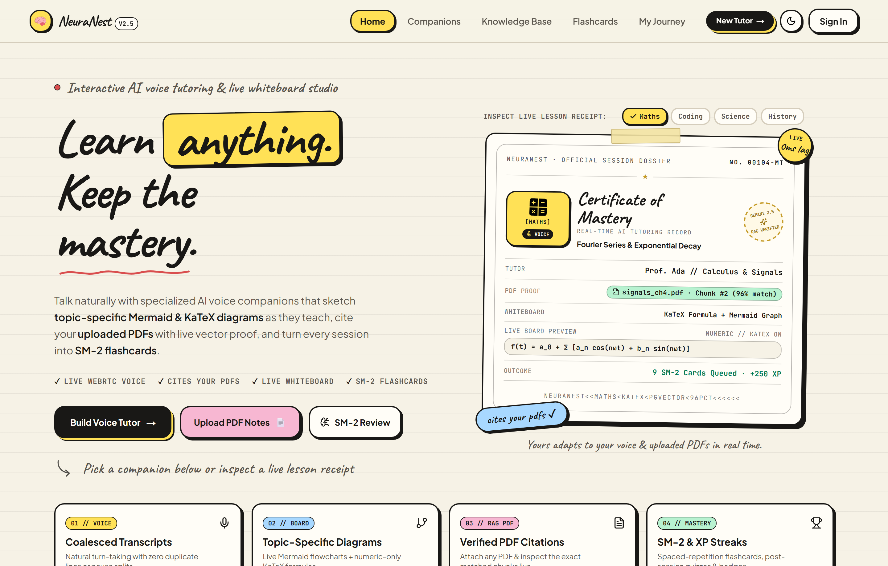
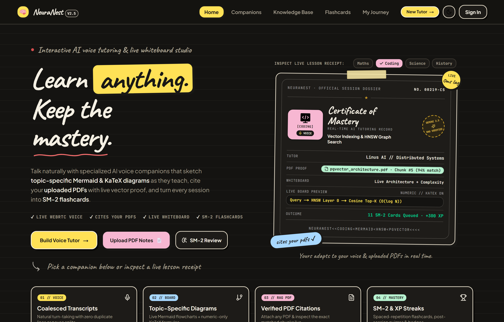
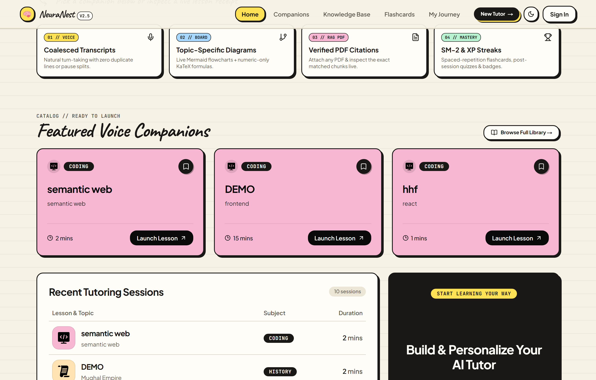
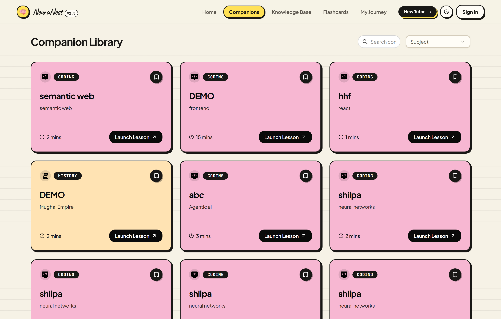
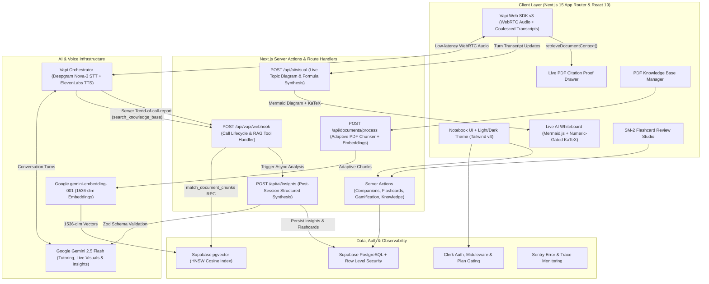
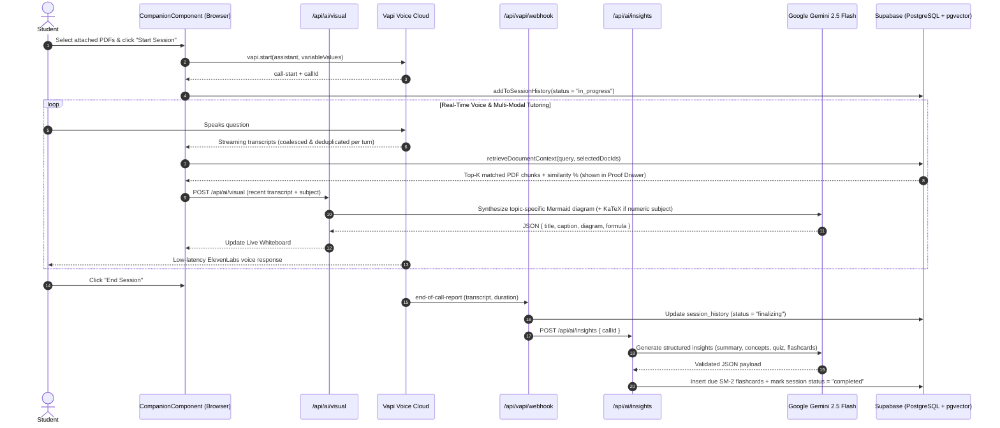
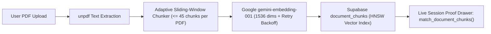
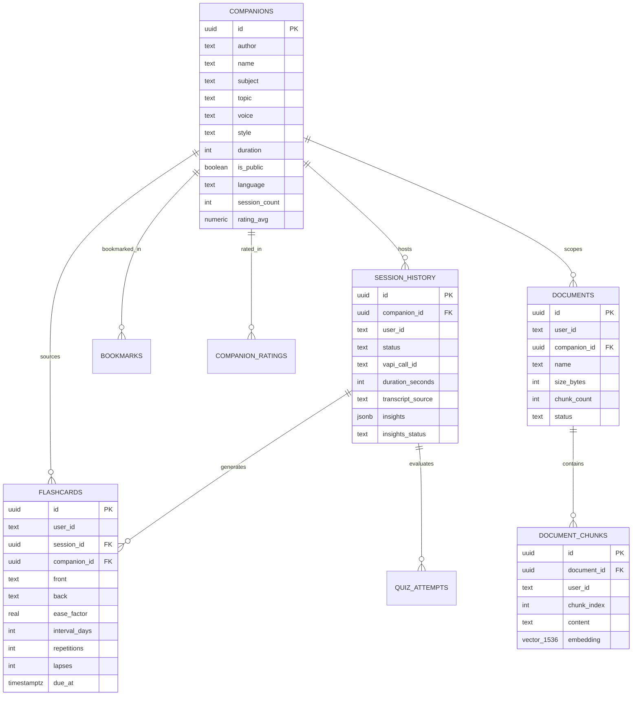

<div align="center">

  <div>
    
    
    
    
    
    
    
    
  </div>

  <br />

  <h1>NeuraNest: Real-Time AI Voice Tutoring and Live Whiteboard Studio</h1>

  <p align="center">
    An interactive AI learning platform combining <strong>low-latency WebRTC voice companions</strong>, <strong>verified RAG document grounding (pgvector)</strong>, a <strong>topic-specific Mermaid and KaTeX live whiteboard</strong>, <strong>SuperMemo SM-2 spaced repetition flashcards</strong>, and <strong>deterministic gamification analytics</strong>.
  </p>

</div>

---

## Interface Gallery

### Editorial Notebook Hero and Interactive Lesson Dossier (Light Mode)


### Warm Espresso Ink Theme and Live Subject Dossier Switcher (Dark Mode)


### Studio Pillars, Featured Voice Companions, and Session Ledger


### Companion Marketplace and Subject Filters


---

## Table of Contents

1. [Overview](#overview)
2. [Key Features](#key-features)
3. [System Architecture](#system-architecture)
4. [Voice Session, Live Whiteboard, and Insights Pipeline](#voice-session-live-whiteboard-and-insights-pipeline)
5. [RAG Knowledge Base and Citation Proof Pipeline](#rag-knowledge-base-and-citation-proof-pipeline)
6. [Database Schema (ERD)](#database-schema-erd)
7. [Tech Stack](#tech-stack)
8. [Local Setup and Environment Variables](#local-setup-and-environment-variables)
9. [Production Deployment Guide (Vercel)](#production-deployment-guide-vercel)
10. [Testing and Verification](#testing-and-verification)

---

## Overview

**NeuraNest** turns passive self-study into an active, multi-modal voice tutoring studio. Learners create or select specialized AI voice companions across subjects (`Maths`, `Science`, `Coding`, `Language`, `History`, `Economics`), attach their own PDF lecture notes from a vector knowledge base, and converse naturally over low-latency WebRTC audio.

During a live voice session, the platform provides:
- **Turn-Coalesced, Deduplicated Live Transcripts**: Consecutive phrases from the same speaker are merged into a single conversational turn so natural speech pauses never fragment a sentence into multiple transcript lines.
- **Verified PDF Grounding and Live Citation Proof**: Learners select which uploaded PDFs to attach before starting a call. Whenever the student speaks, semantic vector search (`pgvector` + Google `gemini-embedding-001`) retrieves the top matching chunks and displays them inside an expandable **Citation Proof Drawer** with similarity scores.
- **Topic-Specific Live Whiteboard**: Powered by Google `gemini-2.5-flash` (`/api/ai/visual`), the live board synthesizes real-time **Mermaid.js** flowcharts tailored to the exact concepts discussed. **KaTeX** mathematical formulas are rendered strictly for numeric subjects (`Maths`, `Science`, `Coding`, `Economics`) and automatically suppressed for humanities subjects (`History`, `Language`).
- **Automated Post-Session Synthesis**: When a session concludes, Gemini generates structured study notes, key concepts, multiple-choice quizzes, and **SuperMemo SM-2 flashcards** ready for spaced-repetition review.

---

## Key Features

- **Real-Time WebRTC Voice Companions**: Configurable AI tutors powered by `@vapi-ai/web` v3, Deepgram Nova-3/Nova-2 speech-to-text, Google `gemini-2.5-flash`, and ElevenLabs voices with sub-second response latency.
- **Dynamic AI Whiteboard (`/api/ai/visual`)**: Synthesizes live Mermaid architecture/process diagrams from the active conversation transcript alongside Vapi client tool calls (`render_diagram` and `render_equation`), with subject-aware KaTeX math gating (`isNumericSubject`).
- **RAG Knowledge Base with Vector Proof (`/knowledge`)**: Server-side PDF text extraction via `unpdf`, adaptive sliding-window chunking that respects free-tier embedding quotas, `1536`-dimensional `gemini-embedding-001` vectors stored in Supabase `pgvector` with an HNSW cosine index, and in-call chunk citation verification.
- **SuperMemo SM-2 Flashcard Studio (`/review`)**: Anki-style spaced repetition deck with four grading buttons (`Again`, `Hard`, `Good`, `Easy`), live next-interval previews, and keyboard shortcuts (`Space`, `1` to `4`).
- **Deterministic Gamification Engine (`/my-journey`)**: XP, level progression, daily and longest study streaks, and 10 achievement badges computed as a pure function over session, quiz, and flashcard records.
- **Zero-Lag Notebook Design System**: Crafted with `Caveat`, `Plus Jakarta Sans`, and `JetBrains Mono` on a warm ruled-notebook surface (`#F6F2E6` Light / `#141311` Dark). Animations follow Emil Kowalski's design engineering rules: composite-only `transform` and `opacity` transitions, custom `--ease-out: cubic-bezier(0.23, 1, 0.32, 1)` curves, zero `background-attachment: fixed` repaints, capability-gated hover lifts (`@media (hover: hover) and (pointer: fine)`), and full `prefers-reduced-motion` support.

---

## System Architecture



---

## Voice Session, Live Whiteboard, and Insights Pipeline



---

## RAG Knowledge Base and Citation Proof Pipeline



---

## Database Schema (ERD)



---

## Tech Stack

| Layer | Technology |
| :--- | :--- |
| **Framework** | Next.js 15.3 (App Router, Server Actions, Turbopack), React 19, TypeScript 5 |
| **Typography & Design** | Tailwind CSS v4, Caveat, Plus Jakarta Sans, JetBrains Mono, Radix UI / shadcn/ui |
| **Voice & AI** | Vapi Web SDK (`@vapi-ai/web` v3.0.1), Google Gemini (`gemini-2.5-flash`, `gemini-embedding-001`), Deepgram, ElevenLabs |
| **Visual Whiteboard** | Mermaid.js v11 (Flowcharts & Architecture Diagrams), KaTeX (Numeric-Gated LaTeX Math) |
| **Database & Vector Search** | Supabase PostgreSQL, `pgvector` (HNSW Cosine Index), Row Level Security (RLS) |
| **Authentication** | Clerk (`@clerk/nextjs`) Middleware Route Protection & Subscription Plan Gating |
| **Observability & Testing** | Sentry (`@sentry/nextjs`), Vitest (Unit Testing) |

---

## Local Setup and Environment Variables

### 1. Clone and install dependencies

```bash
git clone https://github.com/ishan1603/NeuraNest.git
cd NeuraNest
npm install
```

### 2. Run Supabase migrations

In your Supabase project's **SQL Editor**, execute the migrations in order:
1. `supabase/migrations/0001_base_schema.sql`
2. `supabase/migrations/0002_v2_platform.sql`

### 3. Configure `.env.local`

Create a `.env.local` file in the project root:

```env
# Clerk Authentication
NEXT_PUBLIC_CLERK_PUBLISHABLE_KEY=pk_test_...
CLERK_SECRET_KEY=sk_test_...
NEXT_PUBLIC_CLERK_SIGN_IN_URL=/sign-in
NEXT_PUBLIC_CLERK_SIGN_UP_URL=/sign-up

# Supabase (Database + pgvector)
NEXT_PUBLIC_SUPABASE_URL=https://your-project-ref.supabase.co
NEXT_PUBLIC_SUPABASE_ANON_KEY=eyJ...
SUPABASE_SERVICE_ROLE_KEY=eyJ...

# Vapi Voice AI (Either variable name is supported)
NEXT_PUBLIC_VAPI_WEB_TOKEN=your_vapi_public_web_token
NEXT_PUBLIC_VAPI_PUBLIC_KEY=your_vapi_public_web_token

# Google Gemini API (Insights, Live Whiteboard Visuals, and 1536-dim Embeddings)
GEMINI_API_KEY=AIzaSy...

# Public App URL (Used by Vapi Server Webhooks)
NEXT_PUBLIC_APP_URL=http://localhost:3000
```

### 4. Start the development server

```bash
npm run dev
```

---

## Production Deployment Guide (Vercel)

### Step 1: Import Repository into Vercel
1. Push your latest `main` branch to GitHub.
2. Open the [Vercel Dashboard](https://vercel.com/new) and import `ishan1603/NeuraNest`.
3. Note that `.npmrc` includes `legacy-peer-deps=true` in the repository root, so Vercel's `npm install` step automatically resolves `@vapi-ai/web@3.0.1` peer dependencies without custom install flags.

### Step 2: Configure Vercel Environment Variables
In **Vercel Project Settings -> Environment Variables**, add the following keys for **Production**, **Preview**, and **Development**:

| Variable Name | Required | Description |
| :--- | :--- | :--- |
| `GEMINI_API_KEY` | Yes | Google AI Studio API key (`AIzaSy...`). Powers `/api/ai/insights`, `/api/ai/visual`, and `gemini-embedding-001` PDF vectorization. (Replaces any legacy `OPENAI_API_KEY`.) |
| `NEXT_PUBLIC_CLERK_PUBLISHABLE_KEY` | Yes | Clerk Publishable Key (`pk_live_...` or `pk_test_...`). |
| `CLERK_SECRET_KEY` | Yes | Clerk Secret Key (`sk_live_...` or `sk_test_...`). |
| `NEXT_PUBLIC_CLERK_SIGN_IN_URL` | Yes | Set to `/sign-in`. |
| `NEXT_PUBLIC_CLERK_SIGN_UP_URL` | Yes | Set to `/sign-up`. |
| `NEXT_PUBLIC_SUPABASE_URL` | Yes | Your Supabase project URL (`https://<project-ref>.supabase.co`). |
| `NEXT_PUBLIC_SUPABASE_ANON_KEY` | Yes | Supabase `anon` public key. |
| `SUPABASE_SERVICE_ROLE_KEY` | Yes | Supabase `service_role` secret key (used server-side for PDF vector ingestion and webhook updates). |
| `NEXT_PUBLIC_VAPI_WEB_TOKEN` | Yes | Your Vapi Public Key / Web Token from the Vapi Dashboard. |
| `NEXT_PUBLIC_APP_URL` | Yes | Your production domain (for example, `https://neuranest.vercel.app`) with no trailing slash. |
| `VAPI_WEBHOOK_SECRET` | Optional | Shared secret header if you enable webhook signature verification in Vapi. |

### Step 3: Post-Deployment Checklist
1. **Clerk Allowed Domains**: In the Clerk Dashboard, add your Vercel production domain (`https://your-domain.vercel.app`) to allowed origins/redirects.
2. **Supabase JWT Template**: Ensure your Clerk `supabase` JWT template is active if using RLS policies tied to `auth.jwt() ->> 'sub'`.
3. **Redeploy after Env Updates**: Anytime you add or change a `NEXT_PUBLIC_*` variable in Vercel, trigger a fresh deployment so Next.js inlines the updated public values at build time.

---

## Testing and Verification

```bash
# Run unit tests (SM-2 Spaced Repetition, Gamification Engine, Plan Quotas)
npx vitest run

# Type-check and lint
npx tsc --noEmit
npm run lint

# Production build check
npm run build
```
